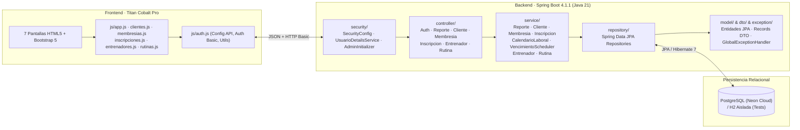

# 🏗️ Arquitectura y Estructura del Proyecto — Titan Fitness Club

## 1. Visión Arquitectónica

**Titan Fitness Club** implementa una arquitectura multicapa desacoplada mediante una API REST stateless en **Spring Boot 4.1.1 (Java 21)** y un cliente web **Titan Cobalt Pro** en HTML5, CSS3, Bootstrap 5.3.3 y JavaScript ES6+.

---

## 2. Organización de Paquetes del Backend (`com.fitcore`)

| Paquete | Responsabilidad | Clases Principales |
|---|---|---|
| `com.fitcore` | Punto de entrada de la aplicación Spring Boot | `BackendApplication` |
| `com.fitcore.config` | Configuración de beans de infraestructura y planificación (`@EnableScheduling`, `Clock`) | `AppConfig` |
| `com.fitcore.security` | Autenticación HTTP Basic stateless, codificación `BCrypt`, CORS y provisión segura del administrador inicial | `SecurityConfig`, `UsuarioDetailsService`, `AdminInitializer` |
| `com.fitcore.controller` | Exposición de endpoints HTTP REST y validación de entrada (`@Valid`) | `AuthController`, `ReporteController`, `ClienteController`, `MembresiaController`, `InscripcionController`, `EntrenadorController`, `RutinaController` |
| `com.fitcore.service` | Reglas de negocio, cálculos de fechas hábiles, renovaciones, sincronización de colecciones JPA y transacciones (`@Transactional`) | `ReporteService`, `ClienteService`, `MembresiaService`, `InscripcionService`, `CalendarioLaboral`, `VencimientoScheduler`, `EntrenadorService`, `RutinaService` |
| `com.fitcore.repository` | Acceso a datos mediante Spring Data JPA y consultas JPQL optimizadas (`JOIN FETCH`) | `UsuarioRepository`, `ClienteRepository`, `MembresiaRepository`, `InscripcionRepository`, `EntrenadorRepository`, `RutinaRepository` |
| `com.fitcore.model` | Entidades JPA y enumerados del dominio | `Usuario`, `Cliente`, `Membresia`, `Inscripcion`, `EstadoInscripcion`, `Entrenador`, `Rutina`, `DiaRutina`, `DiaSemana`, `EjercicioRutina` |
| `com.fitcore.dto` | Objetos inmutables (`record`) de entrada y salida para desacoplar la API del modelo JPA | `InscripcionRequestDTO`, `InscripcionResponseDTO`, `ResumenInscripcionesDTO`, `RutinaRequestDTO`, `RutinaResponseDTO`, `DiaRutinaDTO`, `EjercicioRutinaDTO`, `ActualizarPesoEjercicioDTO`, `CambioPasswordRequestDTO` |
| `com.fitcore.exception` | Manejo centralizado de excepciones (`@RestControllerAdvice`) y respuestas de error estandarizadas | `GlobalExceptionHandler`, `ErrorResponse`, `RecursoNoEncontradoException`, `ReglaDeNegocioException` |

> **Nota sobre conservación de tablas históricas en PostgreSQL**: Las clases Java obsoletas de módulos heredados fueron eliminadas del código productivo para mantener una arquitectura limpia centrada en Membresías, Inscripciones y Rutinas, mientras que en la base de datos nunca se ejecuta `DROP TABLE`, preservando intactos los datos históricos existentes en Neon Cloud.

---

## 3. Organización del Frontend (`frontend/`)

- **`css/style.css`**: Sistema de diseño **Titan Cobalt Pro** con variables CSS semánticas (`--navy-900`, `--primary`, `--sky-accent`), layout responsive, tarjetas ejecutivas `.dashboard-stat`, barras de distribución `.metric-distribution-card`, catálogo `.plan-card-cobalt` y bloques del constructor de rutinas.
- **`js/auth.js`**: Núcleo compartido cargado en todas las pantallas protegidas. Centraliza:
  - `API_BASE` y el mapa inmutable `ENDPOINTS`.
  - Interceptor global de `window.fetch` que inyecta `Authorization: Basic <token>` y redirige a `login.html` ante `401 Unauthorized`.
  - Temporizador de cierre automático por inactividad (15 minutos con aviso previo de 1 minuto) y cambio seguro de contraseña (`PUT /api/auth/password`).
  - Helpers reutilizables: `extraerMensajeError`, `mostrarAlertaUI`, `asignarTexto`, `obtenerIniciales`, `obtenerNombreCompleto`, `formatearFechaLocal`, `formatearFechaHoraLegible` y `badgeEstadoInscripcion`.
- **Módulos por pantalla**:
  - `login.html`: Autenticación contra `GET /api/auth/me` con bloqueo temporal ante intentos fallidos consecutivos.
  - `index.html` + `js/app.js`: Dashboard ejecutivo y radar de vencimientos en días hábiles.
  - `clientes.html` + `js/clientes.js`: CRUD de socios y expediente 360° con línea de tiempo de membresías y progreso de rutinas.
  - `membresias.html` + `js/membresias.js`: Catálogo visual y técnico de planes de membresía.
  - `inscripciones.html` + `js/inscripciones.js`: Asignación, activación directa, cancelación con motivo, renovación con trazabilidad de origen e historial.
  - `entrenadores.html` + `js/entrenadores.js`: Administración de entrenadores activos e inactivos.
  - `rutinas.html` + `js/rutinas.js`: Constructor dinámico de rutinas, días de la semana, seguimiento de ejercicios completados y control de peso (`kg`).
