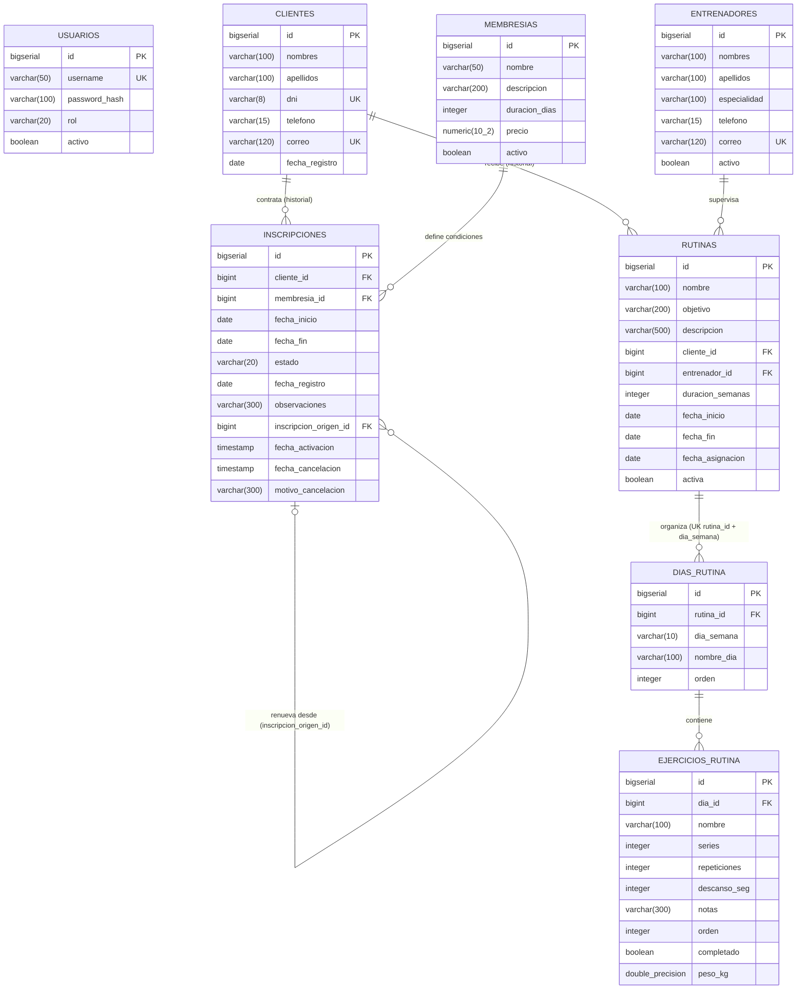

# 🗄️ Modelo de Datos y Migración SQL — Titan Fitness Club

## 1. Diagrama Entidad-Relación (MER)

---

## 2. Decisiones de Integridad y Sincronización JPA

1. **Separación entre Plan (`membresias`) e Inscripción (`inscripciones`)**:
   - `membresias.activo` indica únicamente si el plan puede seleccionarse en **nuevas** inscripciones.
   - `inscripciones.estado` (`PENDIENTE`, `ACTIVA`, `VENCIDA`, `CANCELADA`) representa la vigencia real del socio.
2. **Restricción de unicidad `uk_dias_rutina_rutina_dia (rutina_id, dia_semana)` y prevención de `SQLState: 23505`**:
   - La tabla `dias_rutina` y la entidad `DiaRutina` incluyen `@UniqueConstraint(name = "uk_dias_rutina_rutina_dia", columnNames = {"rutina_id", "dia_semana"})` para impedir que una misma rutina tenga dos veces el mismo día (por ejemplo, dos `LUNES`).
   - Al actualizar una rutina en `RutinaService.aplicarDatos(...)`, el servicio **reutiliza las instancias existentes de `DiaRutina` cuyo `DiaSemana` coincide** y solo elimina mediante `removeIf(...)` los días que fueron descartados, evitando que Hibernate ejecute un `INSERT` duplicado antes del `DELETE` de huérfanos (`SQLState: 23505`).
   - Las colecciones `Rutina.dias` y `DiaRutina.ejercicios` cuentan con `@BatchSize(size = 50)` para evitar consultas `N+1` al calcular los indicadores de progreso con `spring.jpa.open-in-view=false`.
3. **Preservación de fechas históricas en `V1__membresias_rutinas_auth.sql` y `V2__progreso_rutinas_y_trazabilidad_inscripciones.sql`**:
   - En PostgreSQL (`V1`), la columna `inscripciones.fecha_registro` se agrega inicialmente sin `DEFAULT`, se puebla con `COALESCE(fecha_inicio, CURRENT_DATE)` para preservar la fecha histórica real de cada inscripción antigua y, finalmente, se configura `SET DEFAULT CURRENT_DATE` para registros futuros.
   - En `V2`, se añaden `completado` (`BOOLEAN NOT NULL DEFAULT FALSE`) y `peso_kg` (`0 <= peso_kg <= 1000`) en `ejercicios_rutina`, así como `inscripcion_origen_id`, `fecha_activacion`, `fecha_cancelacion` y `motivo_cancelacion` en `inscripciones`, poblando con backfill seguro el motivo de las cancelaciones históricas previas a `V2`.
   - Se utiliza `ON DELETE RESTRICT` en las claves foráneas principales y `ON DELETE SET NULL` en `inscripcion_origen_id` para impedir borrados accidentales en cascada del historial.
